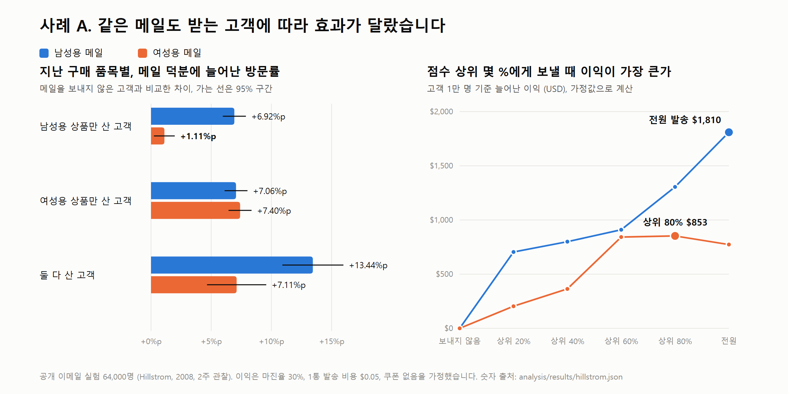

# CRM LOOP

누구에게, 무엇을, 언제 보낼지 정하고, 그 판단이 맞았는지 확인하는 CRM 마케팅 기획 포트폴리오입니다. 캠페인 기획서 세 편이 중심이고, 기획에 쓴 근거는 공개 데이터 분석으로 따로 정리했습니다.

[재방문 캠페인 기획서](docs/CAMPAIGN-BRIEF.md) | [VIP 행사 기획안 PDF](public/downloads/CRM-LOOP-Case-B-Plan.pdf) | [비수기 캠페인 기획안](docs/CASE-C-SEASONAL-STAY.md) | [전체 문서 안내](#문서와-코드-안내)

## 30초 안내

- **무엇을 정하는가:** 캠페인마다 받을 고객, 보낼 메시지, 보낼 시점을 정합니다. 기획서마다 보내지 않는 고객을 일부 남겨, 메시지가 없어도 샀을 고객을 빼고 메시지 덕분에 늘어난 몫만 성과로 셉니다.
- **기획서 세 편:** 이탈 위험 고객 재방문 캠페인, 향 브랜드 VIP 프리뷰 행사(사례 B), 숙박 브랜드 비수기 캠페인(사례 C)입니다.
- **기획 근거:** 공개 이메일 실험(사례 A)으로 메일마다 받을 고객을 골라야 하는지 확인했고, 실제 거래 기록(고객 가치 분석)으로 어떤 고객에게 먼저, 언제 연락할지 정했습니다.
- **공통 기준:** 세 기획서가 같은 [KPI 정의서](docs/KPI.md)와 동의 기준을 씁니다. 열람은 반응으로 세지 않고, 비교군이 없으면 `효과`라고 부르지 않습니다.



여성용 메일은 남성용 상품만 사던 고객에게 거의 효과가 없었고(+1.11%p), 상위 80%에게만 보낼 때 이익이 가장 컸습니다. 남성용 메일은 전원에게 보낼 때 이익이 가장 컸습니다. 그래서 재방문 캠페인은 쿠폰 없이 시작하고, 비수기 캠페인은 고객이 고른 조건에 따라 제안을 나눕니다.

## 캠페인 기획서

### 기획서 1. 이탈 위험 고객 재방문 캠페인

| 정한 것 | 내용 | 근거 |
|---|---|---|
| 누구에게 | 이탈 위험 고객 666명 (2011-12-01 기준, 지난 12개월 매출의 9.3%) | 다음 해에 63.2%가 다시 샀습니다. 휴면 고객은 29.8%였습니다. 마지막 구매 뒤 경과일 중앙값이 121일인, 사다가 멈춘 고객입니다. |
| 무엇을 | 1차 신상품과 재입고 소식, 2차 함께 많이 팔리는 품목 추천, 3차 받고 싶은 소식 고르기. 쿠폰은 붙이지 않습니다. | 사례 A에서 20% 쿠폰을 붙이면 두 메일 모두 보내지 않는 편이 나았습니다. |
| 언제 | 겨울 기준일 전후에 첫 회차를 보내고, 앞 메일에 반응이 없을 때만 다음 메일을 보냅니다. | 90일 재구매율이 겨울(33.1%)이 가을(49.6%)보다 낮았습니다. 가을에는 연말 수요 때문에 메일 효과와 계절 효과가 섞입니다. |
| 맞았는지 | 보내지 않는 고객을 30% 남기고, 같은 설계로 6회차를 모아 늘어난 90일 재구매율만 성과로 셉니다. | 666명 한 회차로는 증분이 11.8%p는 되어야 잡혀, 5%p를 잡을 수 있는 회차 수를 계산했습니다. |

**판단:** 첫 회차는 쿠폰 없는 메일로 메일 덕분에 늘어난 재구매를 먼저 확인하고, 쿠폰은 다음 회차에 따로 시험합니다. 발송 흐름은 [Journey 설계도](docs/JOURNEY.md)에 있습니다.

### 기획서 2. VIP 프리뷰에서 재방문까지 (사례 B)

향 브랜드 신제품 프리뷰를 가정한 가상 행사입니다. 실제 브랜드가 연 행사가 아닙니다.

| 기획 항목 | 정한 내용 |
|---|---|
| 행사 목표 | 초대한 고객이 행사 뒤 30일 안에 상담, 예약, 구매로 다시 찾아오게 합니다. |
| 초청 대상과 기준 | 기존 우수 및 재구매 고객 70명, 고관여 잠재 고객 80명, 콘텐츠 크리에이터 30명, 휴면 VIP 60명. 고객군마다 초청 이유와 제외 조건을 정했습니다. |
| 경험 설계 | 시간대별 입장으로 대기를 줄이고, 차 안의 장면별로 향을 비교하게 하고, 체험이 마감되면 대체 샘플과 재예약 중 고르게 합니다. |
| 후속 메시지 | 구매한 고객에게는 사용 팁과 리필 시점, 상담을 요청한 고객에게는 예약 안내, 관심만 보인 고객에게는 고른 향을 담은 안내를 최대 2회 보냅니다. |
| 성과 기준 | 초청 응답률, 참석률, 체험 완료율, 마케팅 동의율, 후속 반응률, 관계 행동률. 분모를 미리 고정했습니다. |

**판단:** 마케팅 동의는 행사 참여와 따로 묻고, 동의한 고객에게만 후속 메시지를 보냅니다. 휴면 VIP는 다른 고객군보다 반응 기대를 낮게 잡고, 반응이 없으면 다시 초청하지 않습니다.

계산용 가상 흐름은 초청 240명, 참석 116명, 마케팅 동의 82명, 관계 행동 28명입니다. **이 수치는 가상 데이터이며 실제 행사 성과가 아닙니다.** 비교군이 없으므로 관계 행동률 34.1%는 반응이고, 행사 덕분에 늘어난 재방문은 초청 대상 일부를 무작위로 남겨 재도록 설계했습니다. 담당자 인계, 누락 업무, 일정 같은 실행 항목은 [기획안](docs/PROJECT-PLAN.md)의 실행 부록에 있습니다.

### 기획서 3. 리셋 미드위크 (사례 C)

호텔과 리조트를 여러 지역에서 운영하는 가상의 숙박 브랜드에서, 봄과 가을의 주중 1박을 지점별 계절 체험과 멤버십 재방문 혜택으로 잇는 자사몰 캠페인입니다. 고객이 동행 형태, 여행 목적, 선호 활동 세 가지를 고르면 지점과 체험 조합을 추천하고, 체크아웃 뒤 남긴 다음 여행 희망 시기를 다음 캠페인의 발송 시점으로 씁니다.

**판단:** 할인보다 맞춤 제안이 나은지 확인하려고 맞춤 제안군, 할인 제안군, 보내지 않는 군으로 무작위로 나누고, 늘어난 예약률과 180일 재예약률을 비교하도록 설계했습니다. 같은 메일도 받는 사람에 따라 효과가 크게 달랐다는 사례 A의 결과가 제안을 나누는 근거입니다. **모든 고객군과 수치는 가상 예시이며, 실제 회사의 캠페인이나 데이터가 아닙니다.** 자세한 내용은 [기획안](docs/CASE-C-SEASONAL-STAY.md)에 있습니다.

## 기획 근거

### 사례 A. 이메일 실험으로 본 발송 대상

<!-- results:start -->
공개 이메일 실험 데이터 64,000명 (남성용 메일, 여성용 메일, 보내지 않음으로 무작위로 나누고 2주 관찰). 아래 숫자는 모두 메일을 보내지 않아도 샀을 고객을 빼고 계산했습니다.

| 질문 | 남성용 메일 | 여성용 메일 |
|---|---|---|
| 메일 덕분에 늘어난 방문률 (95% 구간) | +7.66%p (7.00 ~ 8.32) | +4.52%p (3.89 ~ 5.16) |
| 메일 덕분에 늘어난 구매율 | +0.68%p (0.50 ~ 0.86) | +0.31%p (0.15 ~ 0.47) |
| 메일 덕분에 늘어난 1인당 매출 (USD) | +$0.77 (0.49 ~ 1.05) | +$0.42 (0.17 ~ 0.68) |
| 반응할 고객을 점수로 골랐을 때 무작위로 고른 것보다 나았나 | 아니오 | 예 |
| 고객 1만 명 기준 이익이 가장 큰 발송 범위 | 전원 ($1,810) | 상위 80% ($853, 전원 발송은 $773) |

- 여성용 메일은 남성용 상품만 사던 고객에게 거의 효과가 없었습니다 (방문률 +1.11%p, 여성용 상품만 사던 고객은 +7.40%p). **판단:** 여성용 메일은 지난 구매 품목을 보고 받을 고객을 고릅니다.
- 여성용 메일은 점수 상위 30%에게만 보내도 메일 덕분에 늘어난 방문의 61%를 얻었습니다. 남성용 메일은 효과가 고객 전체에 고르게 퍼져 있어 점수로 골라도 무작위와 차이가 없었습니다. **판단:** 남성용 메일은 고객을 고르지 않고 전원에게 보냅니다.
- 이익 계산은 마진율 30%, 1통 발송 비용 $0.05, 쿠폰 없음이라는 **가정값**입니다. 같은 마진율에서 발송 비용이 $0.25로 오르면 남성용 메일도 상위 20%만 보내는 편이 낫고, 20% 쿠폰을 붙이면 두 메일 모두 보내지 않는 편이 낫습니다. **판단:** 이 캠페인에는 쿠폰을 붙이지 않고, 발송 비용이 바뀌면 발송 범위를 다시 계산합니다.
- 여성용 메일의 상위 80% 이익 $853의 95% 범위는 $248 ~ $1,457입니다. 상위 60%, 80%, 전원 발송의 차이는 이 범위 안에 있습니다. **판단:** 하위 고객을 빼는 결정은 다음 실험에서 확인할 때까지 미룹니다.

점수 모델, Qini 곡선, 민감도 표 같은 분석 세부 사항은 [캠페인 측정 문서](docs/CAMPAIGN-MEASUREMENT.md)에 있습니다.
<!-- results:end -->

숫자는 모두 `analysis/results/hillstrom.json` 한 파일에서 나옵니다. 이 구간과 [캠페인 측정 문서](docs/CAMPAIGN-MEASUREMENT.md)는 스크립트가 만들고, 자동 검사가 파일과 다르면 실패합니다.

같은 두 질문(방문 증분 대비 구매 증분, 업리프트 순위로 대상을 자를 때의 이익)을 2018년 공개된 Criteo 광고 실험 1,398만 명으로 다시 확인했습니다. 결과는 [캠페인 측정 문서 7장](docs/CAMPAIGN-MEASUREMENT.md)에, 계산은 [분석 코드](analysis/criteo.py)에 있고 숫자는 `analysis/results/criteo.json`에서 나옵니다.

### 고객 가치 분석. 거래 기록으로 본 연락 대상과 시점

영국 온라인몰의 실제 거래 기록(Online Retail II, 2009-12-01 ~ 2011-11-30)으로 고객이 언제 떠나는지, 어떤 고객군이 다음 해에 다시 사는지, 고객이 앞으로 낼 매출을 예측하는 모델이 단순 기준보다 나은지를 확인했습니다.

**판단:** 재방문 캠페인의 대상은 휴면 고객이 아니라 이탈 위험 고객으로 정했습니다. 자세한 내용은 [고객 가치 분석](docs/CUSTOMER-VALUE.md)에 있습니다.

## 데이터와 근거의 경계

| 구분 | 내용 | 쓰인 곳 |
|---|---|---|
| 공개 실제 데이터 | Online Retail II 거래 기록 (2009~2011, 영국 온라인몰) | 재방문 캠페인의 대상과 시점, 고객 가치 분석 |
| 공개 실제 데이터 | Hillstrom 이메일 실험 (2008, 미국 온라인 소매) | 사례 A, 메일 덕분에 늘어난 반응과 고객군별 차이, 표본 수 |
| 가정값 | 마진율, 발송 비용, 쿠폰율 | 사례 A 이익 계산, 민감도 표로 범위 제시 |
| 가상 데이터 | 초청 고객 수와 퍼널, 숙박 고객군 | 사례 B, 사례 C |
| 설계 제안 | 동의 기준, 접촉 정책, 측정 계획, 세 군 실험 | 세 기획서 공통, 사례 C |

원문 데이터와 API 키는 저장소에 넣지 않습니다. 실제 회사의 고객 자료나 제가 집행한 캠페인의 성과는 포함하지 않습니다.

## 남은 검증과 한계

- 재방문 캠페인은 기획과 측정 설계까지입니다. 접촉 상한과 대기 기간은 제가 정한 설계 값이고, 실제 발송은 하지 않았습니다.
- 사례 B는 가상 데이터라 초청 기준과 후속 메시지가 재방문을 늘리는지 검증하지 못했습니다.
- 사례 C는 기획과 실험 설계까지입니다. 봄, 가을 주중 수요가 실제로 비어 있는지, 지점별 체험을 운영할 수 있는지는 내부 데이터와 운영 담당자 확인이 필요합니다.
- 사례 A는 2008년 미국 데이터이고 관찰 기간이 2주입니다. 지금의 채널 환경이나 다른 업종에 그대로 옮길 수 없습니다.
- 수신거부율은 공개 데이터에 없어 `미측정`입니다. 메일 덕분에 늘어난 이익이 양수여도 수신거부가 늘면 판단이 바뀔 수 있습니다.
- 여성용 메일에서 하위 고객을 빼는 판단은 이익 차이가 신뢰구간 안에 있어 다음 실험으로 확인할 가설입니다.
- 고객 가치 분석은 실험이 아닌 거래 기록이라 고객군 사이의 차이를 캠페인 효과라고 부르지 않습니다. 고객 중 도매상이 많아 개인 고객 업종과 숫자가 다를 수 있습니다.

## 웹 화면

`npm start`로 여는 웹 화면은 첫 화면에서 기획서 세 편과 기획 근거를 함께 보여 주고, 메뉴마다 기획을 직접 바꿔 볼 수 있게 했습니다.

| 메뉴 | 확인할 수 있는 것 |
|---|---|
| 포트폴리오 | 기획서 세 편, 기획 근거, VIP 행사 기획안 요약과 PDF, Excel 내려받기 |
| CRM 전략 | 고객군, 연락 조건, 측정 기준 |
| 사례 A 캠페인 측정 | 메일 덕분에 늘어난 방문과 구매, 마진율과 발송 비용, 쿠폰율을 바꿨을 때 이익이 가장 큰 발송 범위 |
| 사례 C 비수기 캠페인 | 고객이 고른 동행, 목적, 활동에 맞춘 제안과 세 군 실험 설계 |
| 이벤트 실행부터 운영, 예산 검토까지 | 사례 B 행사의 초청, 현장, 후속 단계에서 빠지는 고객과 업무, 지역과 공간 비교, 대기와 인력, 비용 가정 |

## 실행

**분석** (사례 A와 고객 가치 분석, Python 3.12 이상)

```sh
python -m venv .venv
.venv/Scripts/python -m pip install -r analysis/requirements.txt
.venv/Scripts/python -I analysis/fetch_data.py
.venv/Scripts/python -I analysis/hillstrom.py
.venv/Scripts/python -I analysis/report.py
.venv/Scripts/python -I analysis/online_retail.py
.venv/Scripts/python -I analysis/customer_report.py
.venv/Scripts/python -m pytest analysis/tests
```

macOS와 Linux에서는 `.venv/Scripts/python`을 `.venv/bin/python`으로 바꿉니다.

**웹 화면** (Node.js 22 이상, 포트폴리오, 사례 A 측정, 사례 B 행사 운영, 사례 C 캠페인)

```sh
npm ci
npm start
```

터미널에 표시된 주소를 브라우저로 엽니다. 서울시 데이터 연결 설정은 [실행 안내](docs/RUNNING.md)를 참고하세요.

```sh
npm test
npm run build
node verify-worker.mjs
```

맨 위 사례 A 차트는 `node scripts/write_case_a_chart.mjs`로 다시 그립니다. 스크립트가 출력하는 Edge 명령을 실행하면 `assets/case-a-results.png`가 바뀝니다.

## 문서와 코드 안내

| 목적 | 위치 |
|---|---|
| 기획서 1. 재방문 캠페인 | [캠페인 기획서](docs/CAMPAIGN-BRIEF.md), [Journey 설계도](docs/JOURNEY.md) |
| 기획서 2. VIP 행사 (사례 B) | [VIP 행사 기획안](docs/PROJECT-PLAN.md), [조사 자료](docs/RESEARCH-SOURCES.md), [기획 판단과 검증 과제](docs/PROJECT-NOTES.md) |
| 기획서 3. 비수기 캠페인 (사례 C) | [비수기 캠페인 기획안](docs/CASE-C-SEASONAL-STAY.md) |
| 기획 근거: 이메일 실험 (사례 A) | [캠페인 측정](docs/CAMPAIGN-MEASUREMENT.md), [분석 코드](analysis/) |
| 기획 근거: 최근 데이터로 재확인 (Criteo 광고 실험) | [캠페인 측정 7장](docs/CAMPAIGN-MEASUREMENT.md), [분석 코드](analysis/criteo.py) |
| 기획 근거: 고객 가치 | [고객 가치 분석](docs/CUSTOMER-VALUE.md) |
| 지표 정의 | [KPI 정의서](docs/KPI.md) |
| 요구사항, 범위, 일정 | [제품 기획서](docs/PRD.md) |
| 웹 화면과 자동 검사 | [웹 코드](public/), [자동 검사](tests/), [분석 검사](analysis/tests/) |

제작자가 기획 범위와 판단 기준을 정하고 분석 설계, 문구, 화면과 계산식을 확인했습니다. 실제 고객 명단이나 내부 매출은 사용하지 않았으며 초청장 발송, 회원 가입과 결제는 진행하지 않았습니다.
