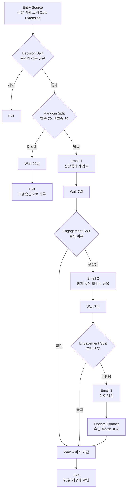

# Journey 설계도: 이탈 위험 고객 재방문

[프로젝트 소개로 돌아가기](../README.md) | [캠페인 브리프](CAMPAIGN-BRIEF.md) | [KPI 정의서](KPI.md)

> [캠페인 브리프](CAMPAIGN-BRIEF.md)를 Marketing Cloud Journey Builder 용어로 옮긴 설계도입니다. 실제 계정 설정은 하지 않았습니다. 대기 기간과 접촉 상한은 제가 정한 설계 값이며, 첫 회차 결과를 보고 고칩니다.

## 1. 흐름

Goal(구매)을 설정해 두어, 어느 단계에서든 구매가 생기면 남은 메일을 보내지 않고 Exit 합니다. 미발송군도 같은 Goal로 구매를 기록해야 두 군을 같은 기준으로 비교할 수 있습니다.

## 2. 단계별 설정

| 단계 | Journey Builder 요소 | 설정 |
|---|---|---|
| 진입 | Entry Source (Data Extension) | RFM 이탈 위험 고객(R 점수 2 이하, F 점수 3 이상). 매일 고객군을 다시 계산하고, 한 고객은 한 번만 진입합니다(Re-entry 없음). |
| 진입 필터 | Decision Split | 마케팅 메일 동의가 있고, 최근 14일 안에 구매하지 않았고, 접촉 상한에 닿지 않은 고객만 통과합니다. |
| 배정 | Random Split | 발송 70%, 미발송 30%. 비율을 고른 근거는 [기획서 1](CAMPAIGN-BRIEF.md)의 표본 설계에 있습니다. 배정 결과를 고객 속성에 남겨 분석에 씁니다. |
| 1차 발송 | Email Activity | 지난번에 산 품목의 신상품과 재입고 소식. 혜택 없음. |
| 대기 | Wait by Duration | 7일 |
| 분기 | Engagement Split | 1차 메일 클릭 여부. 클릭한 고객은 추가 발송 없이 기다립니다. |
| 2차 발송 | Email Activity | 무반응 고객에게 함께 많이 팔리는 품목 추천. |
| 3차 발송 | Email Activity | 2차도 무반응이면 받고 싶은 소식과 빈도를 고르게 하는 선호 갱신 메일. |
| 상태 갱신 | Update Contact | 세 번 모두 무반응이면 휴면 후보로 표시해 다음 캠페인의 접촉 빈도를 낮춥니다. |
| 종료 | Goal, Exit | 구매하면 바로 종료. 아니면 진입 뒤 90일에 종료하고 90일 재구매 여부를 기록합니다. |

## 3. 접촉 정책

[KPI 정의서](KPI.md)의 동의와 접촉 기준을 이 Journey에 적용한 값입니다.

| 항목 | 설계 값 | 이유 |
|---|---|---|
| 이 Journey의 최대 발송 수 | 1명당 3통 | 반응이 없을 때 더 보내기보다 선호를 묻는 것으로 끝냅니다. |
| 전체 마케팅 메일 상한 | 1명당 7일에 2통 | 다른 Journey와 겹칠 때 이 상한을 넘으면 진입 필터에서 제외합니다. |
| 무반응 처리 | 3통 연속 무반응이면 휴면 후보 | 휴면 고객은 다시 산 비율이 29.8%로 낮아([고객 가치 분석](CUSTOMER-VALUE.md)) 큰 시즌 안내만 보냅니다. |
| 수신거부 | 요청 즉시 모든 Journey에서 제외 | 다음 발송 직전에 동의 상태를 다시 확인합니다. |

## 4. 동의 기록

진입 필터는 아래 네 항목이 모두 있는 고객만 통과시킵니다. [사례 B](PROJECT-PLAN.md)에서 행사 동의를 기록한 방식과 같습니다.

| 항목 | 예시 |
|---|---|
| 목적 | 마케팅 안내 |
| 채널 | 이메일 |
| 동의 시각 | 고객이 동의한 날짜와 시각 |
| 정책 버전 | 동의 당시 개인정보 처리방침 버전 |

## 5. 결과를 읽는 방법

- 비교는 Random Split의 두 갈래끼리만 합니다. 클릭한 고객과 무반응 고객을 비교하면 원래 관심이 많은 고객과 적은 고객을 비교하게 됩니다.
- 2차, 3차 메일의 효과를 따로 재려면 무반응 갈래 안에서 다시 무작위로 나눠야 합니다. 첫 회차에서는 Journey 전체의 효과만 잽니다.
- 증분 재구매율, 증분 이익, 수신거부율의 판단 기준은 [캠페인 브리프](CAMPAIGN-BRIEF.md) 1장을 따릅니다.
